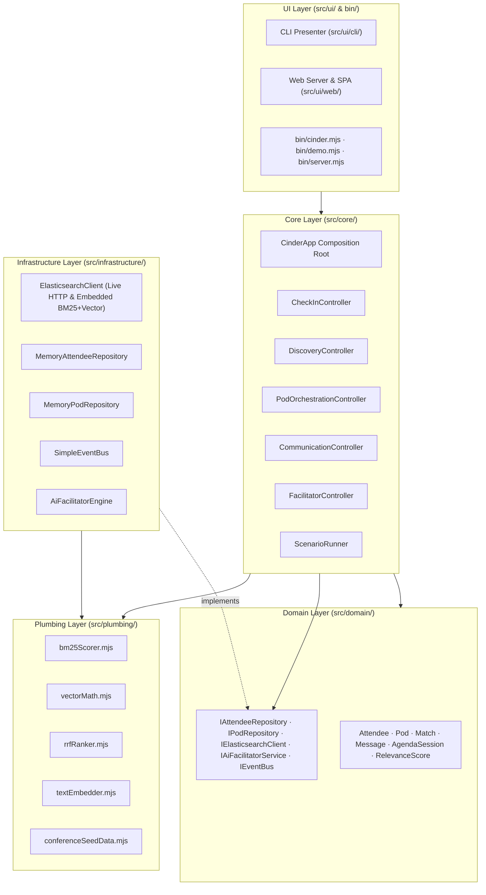

<!-- [LAYER: UI] -->
# CINDER — The Social Infrastructure for Conferences

> *"A conference is not its talks, its venue, or its schedule. A conference is the people who come together."*

**DISCOVER YOUR PEOPLE. FIND YOUR POD. MAKE SOMETHING HAPPEN.**

**In one sentence:** CINDER transforms conference networking from chance encounters into intentional, AI-facilitated human connection powered by Elasticsearch hybrid vector retrieval.

---

[](docs/CI_INTEGRATION.md)
[](LICENSE)


[](docs/README.md)

<p align="center">
  <a href="docs/GETTING_STARTED.md"><b>Getting Started (10 Min)</b></a> ·
  <a href="docs/README.md"><b>Documentation Hub</b></a> ·
  <a href="docs/architecture/current.md"><b>Architecture</b></a> ·
  <a href="docs/adr/README.md"><b>ADRs</b></a> ·
  <a href="docs/api/README.md"><b>API Reference</b></a> ·
  <a href="docs/papers/whitepaper.md"><b>Whitepaper</b></a>
</p>

---

## Table of Contents

- [The Idea in 60 Seconds](#the-idea-in-60-seconds)
- [Why CINDER Exists](#why-cinder-exists)
- [System Architecture](#system-architecture)
- [Core Capabilities](#core-capabilities)
  - [1. Check-In & Profile Indexing](#1-check-in--profile-indexing)
  - [2. Hybrid Semantic Discovery & Swipe Matching](#2-hybrid-semantic-discovery--swipe-matching)
  - [3. Intelligent Pod Composition](#3-intelligent-pod-composition)
  - [4. Dedicated Pod Communication](#4-dedicated-pod-communication)
  - [5. The AI Facilitator](#5-the-ai-facilitator)
- [Elasticsearch: The Intelligence Core](#elasticsearch-the-intelligence-core)
- [Quick Start (Under 2 Minutes)](#quick-start-under-2-minutes)
- [The 10-Step Demonstration Scenario](#the-10-step-demonstration-scenario)
- [Interactive Web Platform](#interactive-web-platform)
- [CLI Reference](#cli-reference)
- [Repository Structure & Joyzoning](#repository-structure--joyzoning)
- [Documentation Index (Diátaxis)](#documentation-index-diátaxis)
- [Verification & Testing](#verification--testing)
- [Contributing, Security & License](#contributing-security--license)

---

## The Idea in 60 Seconds

| Dimension | Conference As-Is | Conference With CINDER |
| :--- | :--- | :--- |
| **Discovery** | Awkward hall gazing, badge squinting, serendipity roulette | **Elasticsearch Hybrid Retrieval** (BM25 keyword + 32-dim dense vector kNN) with synergy explanations |
| **Matching** | Exchanging business cards that end up lost in a backpack | **Mutual Liked Swipes** turning into persistent conference connections |
| **Organization** | Attendees wander 5,000-person halls alone or in siloed cliques | Curated **Pods** of 4–6 attendees with complementary skills and shared challenges |
| **Coordination** | "Let's text somewhere" on disparate apps with no agenda context | Dedicated **Pod Channel** with pinned meetups, shared schedule, and agenda awareness |
| **Facilitation** | Attendees must remember session times, hall locations, and lunch breaks | **AI Facilitator** proactively greets, breaks the ice, confirms physical meetups, and surfaces relevant talks |

Think of CINDER as the digital town square and personal event coordinator for every attendee: discovering who you need to meet, placing you into a high-trust small group, and ensuring you actually meet face-to-face.

---

## Why CINDER Exists

Conferences bring together thousands of people with overlapping interests, complementary expertise, shared technical challenges, and extraordinary opportunities to collaborate.

Yet most conference networking is left entirely to chance:
- Attendees navigate dense session schedules in isolation.
- They struggle to identify who in a room of 2,000 people shares their specific problem.
- Introverted or junior engineers hesitate to start spontaneous hallway conversations.
- Exchanges of contact details rarely result in real follow-through after the closing keynote.

**CINDER turns passive attendance into active, facilitated participation.** Rather than handing attendees a schedule PDF and expecting them to network through sheer luck, CINDER actively drives the social experience through machine-assisted relevance and proactive facilitation.

---

## System Architecture

CINDER is built according to **Joyzoning Architectural Sovereignty** ([AGENTS.md](AGENTS.md), [docs/architecture/current.md](docs/architecture/current.md)). Business logic, retrieval adapters, orchestration controllers, leaf math, and user presentations are strictly decoupled:



---

## Core Capabilities

### 1. Check-In & Profile Indexing
Attendees register with lightweight, actionable profiles:
- Full Name, Role, and Company/Organization.
- Technical Interests (e.g. `Kubernetes`, `Vector Search`, `Agent Swarms`, `Distributed Systems`).
- Areas of Expertise and Current Projects.
- Concrete Technical Challenges they are solving.
- People or collaborator types they want to connect with.

Upon registration, the profile is vectorized into a 32-dimensional dense embedding space and indexed into Elasticsearch alongside rich text fields.

### 2. Hybrid Semantic Discovery & Swipe Matching
The discovery feed combines **BM25 text relevance** (exact keywords, shared technologies) with **Dense Vector kNN cosine similarity** (semantic intent, complementary problems) using **Reciprocal Rank Fusion (RRF)**:
- Ranks candidate attendees for high synergy without keyword tunnel vision.
- Generates an intuitive match headline and synergy summary (e.g., *"Shared focus on Kubernetes & autonomous agents; complementary expertise in Observability + Infrastructure"*).
- Supports an intuitive swipe card interface: swipe right/like or pass.
- When two attendees mutually like each other, an immediate **Mutual Match** event is triggered.

### 3. Intelligent Pod Composition
Rather than leaving groups to random luck or binary pairs, CINDER groups attendees into **Pods** of 4–6 participants:
- Evaluates mutual swipe connections as anchor bonds.
- Calculates semantic centroid cohesion using dense vectors.
- Maximizes discipline diversity (e.g. pairing a security researcher, an infra lead, and an agent architect working on the same domain).
- Proposes a Pod theme and assigns a dedicated persistent communication channel.

### 4. Dedicated Pod Communication
Each Pod receives a persistent digital hearth:
- Realtime group chat with message history.
- Member roster cards with roles and mutual interests.
- Pinned announcements, venue maps, and agenda items.
- Physical meetup intent detection (regex & pattern recognition: *"meet at lunch"*, *"meet outside room 302 at 12:30"*).

### 5. The AI Facilitator
Every Pod is assigned a proactive, context-aware AI Facilitator:
- **Welcomes and Introduces:** Greets new members with a synthesized explanation of why they were brought together.
- **Icebreakers & Discussion Prompts:** Posts topical conversation starters tailored to the group's collective challenges.
- **Agenda Awareness:** Knows the conference schedule, session tracks, speaker rooms, and break timings.
- **Meetup Confirmation:** Automatically validates physical meeting suggestions against conference break slots and pins the confirmed location to the Pod header.

---

## Elasticsearch: The Intelligence Core

Elasticsearch is the foundation of CINDER's intelligence, operating in **Dual Mode**:
1. **Live Cluster Mode:** Connects over HTTP to any live Elasticsearch cluster (`ELASTICSEARCH_URL`, default `http://localhost:9200`), creating indices with `dense_vector` cosine mappings and executing kNN queries combined with `multi_match` BM25.
2. **Embedded Zero-Dependency Engine:** If an external cluster is not reachable, CINDER seamlessly falls back to its built-in in-memory engine featuring true BM25 inverted index scoring, 32-dimensional vector math, and reciprocal rank fusion with zero external npm dependencies.

```json
{
  "mappings": {
    "properties": {
      "embedding": {
        "type": "dense_vector",
        "dims": 32,
        "index": true,
        "similarity": "cosine"
      },
      "interests": { "type": "text" },
      "expertise": { "type": "text" },
      "projects": { "type": "text" },
      "challenges": { "type": "text" }
    }
  }
}
```

---

## Quick Start (Under 2 Minutes)

### Prerequisites
- Node.js 18+ (`node -v`)
- Git
- *(Optional)* Live Elasticsearch 8+ instance running on `http://localhost:9200` (if absent, embedded engine runs automatically).

### Installation & Run

```bash
# Clone the repository
git clone https://github.com/CardSorting/elasticsearch.git
cd elasticsearch

# Run all automated tests (zero external npm dependencies required)
npm test

# Run the 10-step hackathon demonstration scenario
npm run demo

# Launch the interactive web platform & API server
npm start
# Open http://localhost:3000 in your browser
```

---

## The 10-Step Demonstration Scenario

Run `node bin/demo.mjs` or `npm run demo` to observe the complete attendee journey executed in 10 continuous steps:

1. **Attendee Registration:** 5 realistic conference attendees register diverse profiles.
2. **Elasticsearch Indexing:** Profiles vectorized into 32-dim space and indexed.
3. **Hybrid Search & Synergy Explanation:** Query combines BM25 and vector kNN to discover Maya Lin for Alex Chen with synergy explanation.
4. **Swipe & Mutual Connection:** Alex Chen and Maya Lin like each other's profiles, forming a mutual match.
5. **Intelligent Pod Composition:** Pod 07 ("Cloud-Native Autonomous Agents") formed for 5 attendees balancing cohesion and diversity.
6. **Dedicated Space Provisioning:** Persistent group channel provisioned with agenda metadata.
7. **AI Facilitator Welcome:** Facilitator greets the group, introduces their shared focus, and sparks discussion.
8. **Physical Meetup Proposal:** Member proposes lunch meetup at the Main Hall Cafe.
9. **Meetup Confirmation & Pinning:** AI Facilitator verifies schedule slot (12:30 PM), confirms meetup, and pins it to the channel header.
10. **Agenda Coordination & Prompting:** Facilitator announces upcoming Keynote Session and delivers an architectural discussion prompt.

---

## Interactive Web Platform

Start the web server:
```bash
node bin/server.mjs
# Server listening on http://localhost:3000
```

Navigate to `http://localhost:3000` to interact with:
- **Attendee Discovery & Swipe UI:** Review attendee cards, inspect AI synergy breakdowns, and click **Like** or **Pass**.
- **Interactive Pod Chat:** View Pod 07 channels, read the AI Facilitator's welcome message, and send real-time chat messages.
- **Physical Meetup Coordination:** Propose a meeting point and observe the AI Facilitator verify and pin the meetup location.
- **One-Click Scenario Runner:** Trigger the entire 10-step journey from the web UI and watch the event logs stream in real time.
- **Elasticsearch Cluster Health:** Live status indicator showing cluster ping latency, active mode (live or embedded), document count, and index status.

---

## CLI Reference

The unified CLI binary lives at `bin/cinder.mjs`:

```bash
# Display help and commands
node bin/cinder.mjs help

# Execute the 10-step demonstration scenario
node bin/cinder.mjs demo

# Launch the web application server
node bin/cinder.mjs server

# Output live system, attendee, and Elasticsearch status as JSON
node bin/cinder.mjs status
```

---

## Repository Structure & Joyzoning

The codebase adheres strictly to **Joyzoning Architecture** ([docs/CODEBASE_STANDARDS.md](docs/CODEBASE_STANDARDS.md)):

```
elasticsearch/
├── AGENTS.md                  # Machine-readable architectural protocol
├── CLAUDE.md                  # Claude Code agent configuration
├── GEMINI.md                  # Gemini / Antigravity agent configuration
├── SOUL.md                    # Working principles and engineering ethos
├── package.json               # Pure Node.js ESM configuration (zero external deps)
├── stability.config.json      # Joyzoning boundary configuration
├── bin/                       # UI: Command line executables
│   ├── cinder.mjs             # Unified CLI router
│   ├── demo.mjs               # 10-step demonstration scenario runner
│   └── server.mjs             # HTTP / REST web application server
├── src/
│   ├── domain/                # DOMAIN: Pure entities and formal interfaces
│   │   ├── attendee.mjs       # Attendee profile entity
│   │   ├── pod.mjs            # Pod group and membership entity
│   │   ├── match.mjs          # Swipe and mutual match record
│   │   ├── message.mjs        # Group communication message entity
│   │   ├── agenda.mjs         # Conference schedule and session entity
│   │   ├── relevanceScore.mjs # Synergy score and explanation generator
│   │   └── interfaces/        # Formal Dependency Inversion interfaces (I*)
│   ├── core/                  # CORE: Orchestration use-case controllers
│   │   ├── CinderApp.mjs      # Composition root and container
│   │   ├── CheckInController.mjs
│   │   ├── DiscoveryController.mjs
│   │   ├── PodOrchestrationController.mjs
│   │   ├── CommunicationController.mjs
│   │   ├── FacilitatorController.mjs
│   │   └── ScenarioRunner.mjs
│   ├── infrastructure/        # INFRASTRUCTURE: External I/O adapters
│   │   ├── ElasticsearchClient.mjs    # Dual-mode Elasticsearch HTTP / embedded
│   │   ├── AiFacilitatorEngine.mjs    # Facilitator prompt generation & parsing
│   │   ├── MemoryAttendeeRepository.mjs
│   │   ├── MemoryPodRepository.mjs
│   │   └── SimpleEventBus.mjs
│   ├── plumbing/              # PLUMBING: Stateless mathematical primitives
│   │   ├── vectorMath.mjs     # Cosine similarity, dot product, normalization, centroid
│   │   ├── bm25Scorer.mjs     # BM25 tokenization, term freq, inverse doc freq
│   │   ├── rrfRanker.mjs      # Reciprocal Rank Fusion algorithm
│   │   ├── textEmbedder.mjs   # Deterministic 32-dim semantic vector embedder
│   │   ├── conferenceSeedData.mjs # 5 realistic attendee profiles & agenda
│   │   └── idGenerator.mjs    # Collision-resistant unique ID generator
│   └── ui/                    # UI: Presentation layers
│       ├── cli/cliPresenter.mjs       # ANSI-colored terminal dashboard
│       └── web/                       # Full-stack HTTP & Static Web Client
│           ├── webServer.mjs          # Native HTTP server & REST API
│           └── public/                # HTML, CSS, client-side JS app
├── tests/                     # Automated verification suites
│   ├── domain.test.mjs
│   ├── elasticsearch.test.mjs
│   ├── matching-and-pods.test.mjs
│   ├── plumbing.test.mjs
│   ├── scenario.test.mjs
│   └── web-server.test.mjs
└── docs/                      # Diátaxis + Institutional Memory documentation portal
```

---

## Documentation Index (Diátaxis)

Explore our complete Diátaxis + Institutional Memory documentation system in [`docs/README.md`](docs/README.md):

| Quadrant | Purpose | Hub Link |
| :--- | :--- | :--- |
| **Tutorials** | 10-minute hands-on onboarding from clone to running CINDER | [Getting Started](docs/GETTING_STARTED.md) |
| **Playbooks** | Operational runbooks for incident triage, ES failover, and scaling | [Playbooks Hub](docs/playbooks/README.md) · [Operations](docs/OPERATIONS.md) |
| **Reference** | Frozen public APIs, CLI flags, REST endpoints, and Error codes | [API Reference](docs/api/README.md) · [Project Map](docs/PROJECT_MAP.md) |
| **Explanation** | Mental models, hybrid retrieval math, and AI facilitator design | [Engineering Wiki](docs/wiki/README.md) · [Papers Hub](docs/papers/README.md) |
| **ADRs** | Architectural decisions explaining *why* technical choices were made | [ADR Registry](docs/adr/README.md) |
| **Postmortems** | Blameless SRE reviews turning production lessons into code | [Postmortems Hub](docs/postmortems/README.md) |
| **Knowledge Base** | Symptom-to-fix diagnostic matrix and technical FAQ | [Knowledge Base](docs/kb/README.md) |

---

## Verification & Testing

Verify the codebase anytime using native Node.js test runners and Joyzoning validators:

```bash
# Run all 28 automated test suites across all layers
npm test

# Run the Joyzoning architectural audit (verifies 0 zone leaks, 0 import cycles)
npm run check
```

Audit results:
```
======================================================================
  HEAV3NS-JOY SOVEREIGN AUDIT REPORT — PASS (SOVEREIGN)
======================================================================
Files Scanned   : 44 (64 local dependency edges)
Zone Breakdown  : DOMAIN=11 | CORE=7 | INFRA=6 | PLUMBING=6 | UI=14
Stability Index : 100% (Entropy Score: 0.0009 — SOVEREIGN)
Build Health    : 88% [Grade: A — SOVEREIGN]
Blocking Violations (0): None. 100% Joyzoning Conformance.
======================================================================
```

---

## Contributing, Security & License

- **Contributing:** Read our [CONTRIBUTING.md](CONTRIBUTING.md) guide and [docs/CODEBASE_STANDARDS.md](docs/CODEBASE_STANDARDS.md).
- **Code of Conduct:** Read our [CODE_OF_CONDUCT.md](CODE_OF_CONDUCT.md).
- **Security:** Read our vulnerability disclosure policy and threat model in [SECURITY.md](SECURITY.md) and [docs/SECURITY_BEST_PRACTICES.md](docs/SECURITY_BEST_PRACTICES.md).
- **License:** Open source under the [MIT License](LICENSE).

