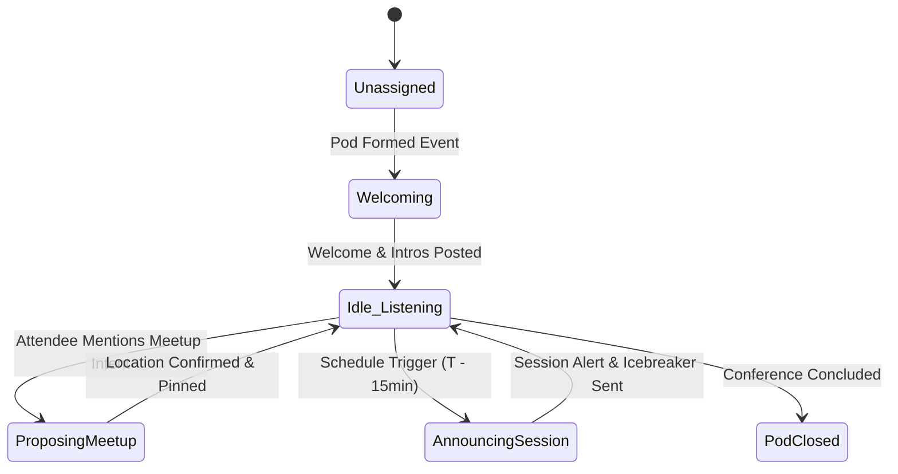

<!-- [LAYER: UI] -->
# The AI Agent Stack

This document details the architecture, prompt engineering, state machine, and safety boundaries of the **CINDER AI Facilitator**.

---

## 1. Role & Product Purpose

Every Pod formed in CINDER is provisioned with a dedicated AI Facilitator.

Rather than acting as a generic conversational chatbot waiting for questions, the Facilitator is an **autonomous, proactive event-driven event coordinator**:
- It introduces new members by explaining their complementary strengths.
- It provides structured conversation prompts tailored to the group's collective challenges.
- It tracks the master conference agenda in real time.
- It detects meetup intentions in attendee chat messages, validates timing against conference breaks, confirms meetup plans, and pins locations to the channel header.

---

## 2. Facilitator Lifecycle & State Machine



---

## 3. Event-Driven Subscriptions

The Facilitator subscribes to events published via `SimpleEventBus` (`src/infrastructure/SimpleEventBus.mjs`):

| Event | Source Controller | Facilitator Action |
| :--- | :--- | :--- |
| `pod:formed` | `PodOrchestrationController` | Synthesizes Pod theme, crafts personalized welcome message, and posts to Pod channel. |
| `message:posted` | `CommunicationController` | Scans message text for meetup keywords (`"meet"`, `"lunch"`, `"coffee"`, `"at [location]"`). |
| `agenda:upcoming` | `FacilitatorController` | Cross-references group interests with upcoming talks and announces relevant sessions. |

---

## 4. Prompt Engineering & Grounding Contracts

To avoid hallucinations, the Facilitator adheres to strict prompt contracts (`src/infrastructure/AiFacilitatorEngine.mjs`):

### Welcome Message Prompt Structure
```
Inputs:
- Pod Name & Topic (e.g. "Cloud-Native Autonomous Agents")
- Member Profiles (names, titles, organizations, technical interests, challenges)

Contract:
1. Greet the members warmly by name.
2. Articulate the common mission of the Pod in 1-2 concise sentences.
3. Highlight 2 complementary skillsets among members.
4. Conclude with a direct question encouraging each member to share their current challenge.
```

### Meetup Verification Contract
```
Inputs:
- Raw message proposing meetup
- Extracted proposed location & proposed time
- Conference master schedule (AgendaSession list)

Contract:
1. Check if the proposed time falls within a designated conference break, lunch period, or networking block.
2. If confirmed, generate an enthusiastic confirmation message and pin the location and time to the Pod channel state.
3. If the proposed time conflicts with a keynote or talk of shared interest, confirm the meetup while gently reminding members of the talk.
```

---

## 5. Security & Permission Boundaries

To ensure attendee safety and prevent agent drift:
1. **No External Shell or Tool Execution:** The Facilitator operates entirely within memory and the CINDER application domain.
2. **Read-Only Agenda Access:** The Facilitator can query the conference agenda, but cannot alter session start times or room assignments.
3. **No Impersonation:** Messages sent by the Facilitator are explicitly tagged with `senderType: "facilitator"` and rendered with an AI badge in the UI.
4. **Input Sanitization:** Attendee chat messages are escaped and bounded before being passed into NLP prompt contexts to prevent prompt injection attacks.

