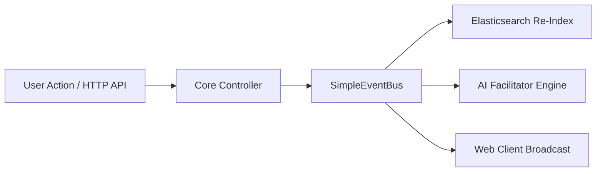

<!-- [LAYER: UI] -->
# Event Bus, Background Queues, & State Synchronization

This guide documents the event-driven architecture, background execution models, and state synchronization primitives in CINDER.

---

## 1. Event-Driven Architecture Overview

CINDER uses a decoupling pattern where asynchronous user actions, search events, and group state changes are published across an event bus (`src/infrastructure/SimpleEventBus.mjs` implementing `src/domain/interfaces/IEventBus.mjs`).



---

## 2. Standard Event Topics

| Topic | Payload | Emitted By | Subscribers |
| :--- | :--- | :--- | :--- |
| `attendee:checked_in` | `{ attendee }` | `CheckInController` | `ElasticsearchClient` (vector indexing), UI notifications |
| `swipe:recorded` | `{ match }` | `DiscoveryController` | `PodOrchestrationController` (evaluates mutual match trigger) |
| `pod:formed` | `{ pod, members }` | `PodOrchestrationController`| `FacilitatorController` (welcome message generation) |
| `message:posted` | `{ message, podId }` | `CommunicationController` | `FacilitatorController` (meetup intent parsing) |
| `meetup:confirmed` | `{ podId, location, time }`| `FacilitatorController` | `Pod.pinLocation()`, Web client stream |

---

## 3. Background Job Queueing

For large-scale conference deployments (5,000+ attendees), long-running tasks like batch re-indexing or large-scale pod partitioning can be offloaded to durable queue workers:

```javascript
import { SimpleEventBus } from "../infrastructure/SimpleEventBus.mjs";

const bus = new SimpleEventBus();

// Subscribe to asynchronous pod composition requests
bus.subscribe("pod:rebalance_requested", async (payload) => {
  await podOrchestrationCtrl.rebalanceConferencePods(payload.conferenceId);
});
```

---

## 4. State Synchronization Guarantees

1. **Idempotent Match Creation:** Multiple swipes between the same pair of attendees resolve to a single idempotent `Match` entity.
2. **Channel Message Ordering:** Messages within a Pod are assigned monotonically increasing timestamps and unique IDs.
3. **Meetup State Consistency:** Pinned meetup updates overwrite older unconfirmed proposals, ensuring all pod members view an identical confirmed location header.

