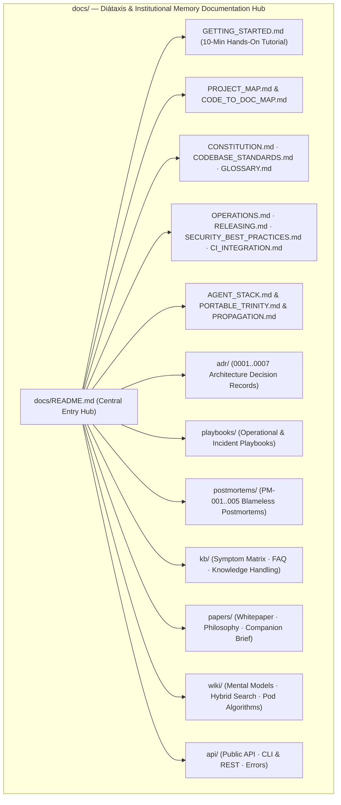

<!-- [LAYER: UI] -->
# CINDER Documentation

Documentation for **CINDER — The Social Infrastructure for Conferences** (`src/`, `bin/`, `tests/`). Organized using the **Diátaxis + Institutional Memory** architecture: Tutorials, Operational Playbooks, Architecture Decision Records (ADRs), Blameless Postmortems, a 3-Tier Knowledge Base, Technical Papers, Engineering Wiki, and API References.

<p align="center">
  <a href="GETTING_STARTED.md">Getting Started</a> ·
  <a href="wiki/README.md">Wiki</a> ·
  <a href="adr/README.md">ADRs</a> ·
  <a href="playbooks/README.md">Playbooks</a> ·
  <a href="postmortems/README.md">Postmortems</a> ·
  <a href="kb/README.md">Knowledge Base</a> ·
  <a href="api/README.md">API & CLI</a> ·
  <a href="papers/companion-brief.md">Papers</a> ·
  <a href="../README.md">Repository README</a>
</p>

---

## Table of contents

- [At a glance](#at-a-glance)
- [Documentation architecture (Diátaxis + Institutional Memory)](#documentation-architecture-diátaxis--institutional-memory)
- [How CINDER differs](#how-cinder-differs)
- [Project configuration](#project-configuration)
- [Start here](#start-here)
- [Reading paths by audience](#reading-paths-by-audience)
- [ADRs, Playbooks, Wiki, Postmortems, & Knowledge Base](#adrs-playbooks-wiki-postmortems--knowledge-base)
- [Where to document what](#where-to-document-what)
- [Release & policy](#release--policy)
- [Specifications & workflows](#specifications--workflows)
- [Architecture & internals](#architecture--internals)
- [Papers](#papers)
- [Runtime & Programmatic API](#runtime--programmatic-api)
- [Local development](#local-development)
- [Principles](#principles)

---

## At a glance

Workspace-verified figures from [papers/companion-brief.md](papers/companion-brief.md) (`v1.0.0`):

| Metric | Value | Source |
| :--- | :--- | :--- |
| Package version | **1.0.0** | [`package.json`](../package.json) |
| External npm runtime dependencies | **0** | [`package.json`](../package.json) |
| Canonical architectural zones | **5** (`DOMAIN`, `CORE`, `INFRA`, `PLUMBING`, `UI`) | [`stability.config.json`](../stability.config.json) |
| Core Controllers | **6** (`CheckIn`, `Discovery`, `PodOrchestration`, `Communication`, `Facilitator`, `Scenario`) | [`src/core/`](PROJECT_MAP.md) |
| Formal Domain Interfaces | **5** (`IAttendeeRepository`, `IPodRepository`, `IElasticsearchClient`, `IAiFacilitatorService`, `IEventBus`) | [`src/domain/interfaces/`](PROJECT_MAP.md) |
| Elasticsearch Modes | **2** (Live HTTP cluster & Embedded zero-dependency engine) | [`src/infrastructure/ElasticsearchClient.mjs`](api/public-api.md) |
| Dense Vector Dimensions | **32** (Normalized cosine distance) | [`src/plumbing/textEmbedder.mjs`](wiki/hybrid-search-and-rrf.md) |
| Retrieval Rank Fusion | **RRF** (k=60 fusion of BM25 + dense kNN) | [`src/plumbing/rrfRanker.mjs`](wiki/hybrid-search-and-rrf.md) |
| CLI Entry Points | **3** (`bin/cinder.mjs`, `bin/demo.mjs`, `bin/server.mjs`) | [`bin/`](api/cli.md) |
| Architecture Decision Records (ADRs) | **7** + template | [`docs/adr/README.md`](adr/README.md) |
| Operational & Incident Playbooks | **5** | [`docs/playbooks/README.md`](playbooks/README.md) |
| Blameless Engineering Postmortems | **5** + template | [`docs/postmortems/README.md`](postmortems/README.md) |
| Knowledge Base Articles & FAQs | **3** | [`docs/kb/README.md`](kb/README.md) |
| Automated verification suites | **6** suites · **28** tests | [`tests/`](../VALIDATION_REPORT.md) |

---

## Documentation architecture (Diátaxis + Institutional Memory)

Modeled on modern engineering documentation standards (Diátaxis, Stripe Docs, Google SRE Runbooks, and MADR):

| Quadrant / Pillar | Purpose | Entry Hub |
| :--- | :--- | :--- |
| **1. Tutorials (Learning)** | Hands-on 10-minute onboarding from clone to running CINDER | [Getting Started](GETTING_STARTED.md) |
| **2. Playbooks & Runbooks (Task / Incident)** | Step-by-step incident triage and failure recovery SOPs | [Playbooks Hub](playbooks/README.md) · [Operations](OPERATIONS.md) |
| **3. Reference (Information)** | Domain models, formal interfaces, CLI flags, REST endpoints, and error catalog | [API Reference](api/README.md) · [Project Map](PROJECT_MAP.md) |
| **4. Wiki & Papers (Explanation)** | Mental models, hybrid retrieval math, pod composition theory, and technical whitepaper | [Engineering Wiki](wiki/README.md) · [Papers Hub](papers/README.md) |
| **5. ADRs (Decision Provenance)** | Immutable MADR records explaining *why* every architectural choice was made | [ADR Registry](adr/README.md) |
| **6. Postmortems (Reliability Memory)** | Blameless SRE postmortems linking past incidents to code safeguards and tests | [Postmortems Hub](postmortems/README.md) |
| **7. Knowledge Base (Symptom & FAQ)** | Symptom-to-fix diagnosis matrix and technical FAQ | [Knowledge Base Hub](kb/README.md) |

---

## How CINDER differs

| Dimension | Typical Conference App / Chatbot | CINDER Platform |
| :--- | :--- | :--- |
| **Search & Discovery** | Primitive name/company string matching or slow opaque vector API | **Hybrid Elasticsearch Retrieval** combining BM25 exact keyword match with 32-dim dense vector cosine similarity via Reciprocal Rank Fusion (RRF) |
| **Grouping Model** | Ad-hoc hallway wandering or binary 1-on-1 speed dating | Curated **Pods of 4–6 attendees** balancing semantic affinity with discipline diversity |
| **Agent Role** | Reactive chatbot waiting for attendee prompts | **Proactive AI Facilitator** with agenda awareness, automatic icebreakers, and physical meetup verification |
| **Reliability & Dependencies** | Brittle cloud dependencies with high latency | **Dual-Mode Adapter** with seamless 250ms zero-dependency embedded fallback running in native Node.js ESM |
| **Architecture Discipline** | Tangled frontend/backend code with hidden side effects | **Joyzoning Sovereign Architecture** (Strict 5-zone decoupling, 100% Stability Index) |



---

## Project configuration

CINDER configuration files:

- **[`package.json`](../package.json):** Pure Node.js ESM package configuration (`"type": "module"`). Scripts: `start`, `demo`, `test`, `check`.
- **[`stability.config.json`](../stability.config.json):** Joyzoning spatial rules configuring zone paths (`src/domain`, `src/core`, `src/infrastructure`, `src/plumbing`, `src/ui`, `bin/`, `docs/`).
- **[`AGENTS.md`](../AGENTS.md):** Agent instructions for architectural conformance.
- **[`SOUL.md`](../SOUL.md):** Guiding design principles and engineering soul.

---

## Start here

If you are new to CINDER, follow this sequence:

1. **Get up and running in 10 minutes:** Follow [GETTING_STARTED.md](GETTING_STARTED.md).
2. **Understand how the system works:** Read [architecture/current.md](architecture/current.md).
3. **Explore the codebase layout:** Consult [PROJECT_MAP.md](PROJECT_MAP.md) and [CODE_TO_DOC_MAP.md](CODE_TO_DOC_MAP.md).
4. **Learn the domain terminology:** Check [GLOSSARY.md](GLOSSARY.md).

---

## Reading paths by audience

- **For New Developers:** [GETTING_STARTED.md](GETTING_STARTED.md) → [CODEBASE_STANDARDS.md](CODEBASE_STANDARDS.md) → [PROJECT_MAP.md](PROJECT_MAP.md) → [api/public-api.md](api/public-api.md).
- **For AI Agents & LLM Harnesses:** [AGENT_STACK.md](AGENT_STACK.md) → [../AGENTS.md](../AGENTS.md) → [../SOUL.md](../SOUL.md) → [wiki/agent-facilitator-design.md](wiki/agent-facilitator-design.md) → [../llms.txt](../llms.txt).
- **For Conference Organizers:** [papers/companion-brief.md](papers/companion-brief.md) → [PROPAGATION.md](PROPAGATION.md) → [papers/philosophy.md](papers/philosophy.md).
- **For Site Reliability Engineers & Operators:** [OPERATIONS.md](OPERATIONS.md) → [playbooks/README.md](playbooks/README.md) → [postmortems/README.md](postmortems/README.md) → [SECURITY_BEST_PRACTICES.md](SECURITY_BEST_PRACTICES.md).
- **For Architects & Tech Leads:** [CONSTITUTION.md](CONSTITUTION.md) → [adr/README.md](adr/README.md) → [papers/whitepaper.md](papers/whitepaper.md) → [wiki/README.md](wiki/README.md).

---

## ADRs, Playbooks, Wiki, Postmortems, & Knowledge Base

Our living institutional memory consists of:

- **[Architecture Decision Records (ADRs)](adr/README.md):** 7 documented decisions capturing the why behind 5 canonical zones, hybrid retrieval, pod algorithms, and embedded fallbacks.
- **[Operational Playbooks](playbooks/README.md):** Actionable runbooks for cluster failover, architectural violation remediation, pod stalls, and conference scaling.
- **[Engineering Wiki](wiki/README.md):** Deep explanations of mental models, vector cosine math, and reciprocal rank fusion.
- **[Blameless Postmortems](postmortems/README.md):** 5 detailed SRE postmortems capturing root cause analyses, 5 Whys, and automated prevention guards.
- **[Knowledge Base](kb/README.md):** Fast symptom-to-diagnosis lookup table and technical FAQ.

---

## Where to document what

| If you are adding... | Put it in... |
| :--- | :--- |
| A hands-on step-by-step guide | [GETTING_STARTED.md](GETTING_STARTED.md) |
| A significant architectural choice | [adr/README.md](adr/README.md) (use [adr/0000-adr-template.md](adr/0000-adr-template.md)) |
| An incident triage procedure | [playbooks/README.md](playbooks/README.md) |
| An analysis of an unexpected failure | [postmortems/README.md](postmortems/README.md) (use [postmortems/0000-postmortem-template.md](postmortems/0000-postmortem-template.md)) |
| A quick fix or frequently asked question | [kb/symptom-diagnosis-matrix.md](kb/symptom-diagnosis-matrix.md) or [kb/faq-and-edge-cases.md](kb/faq-and-edge-cases.md) |
| A deep technical essay or algorithm proof | [papers/whitepaper.md](papers/whitepaper.md) or [wiki/README.md](wiki/README.md) |
| An API symbol, route, or error code | [api/public-api.md](api/public-api.md), [api/cli.md](api/cli.md), or [api/errors.md](api/errors.md) |

---

## Release & policy

- **Release Runbook:** [RELEASING.md](RELEASING.md) covers semantic versioning, release tagging, and verification.
- **Security Policy:** [SECURITY_BEST_PRACTICES.md](SECURITY_BEST_PRACTICES.md) and [../SECURITY.md](../SECURITY.md) govern vulnerability disclosures and sandbox boundaries.
- **Maintainer Guidelines:** [MAINTAINER.md](MAINTAINER.md) defines PR review criteria and test coverage expectations.
- **Continuous Integration:** [CI_INTEGRATION.md](CI_INTEGRATION.md) describes our automated test and Joyzoning gates.

---

## Specifications & workflows

- **System Architecture:** Detailed topological layers in [architecture/current.md](architecture/current.md).
- **Core Tenets:** The 6 fundamental engineering laws in [CONSTITUTION.md](CONSTITUTION.md).
- **Agent Stack:** Facilitator lifecycle and prompt engineering in [AGENT_STACK.md](AGENT_STACK.md).
- **Event Orchestration & Queues:** Background execution and event loops in [PORTABLE_TRINITY.md](PORTABLE_TRINITY.md).
- **Adoption & Propagation:** Field guide for conference rollouts in [PROPAGATION.md](PROPAGATION.md).

---

## Architecture & internals

CINDER strictly implements Joyzoning:
- `src/domain/`: Pure business models (`Attendee`, `Pod`, `Match`, `Message`, `AgendaSession`, `RelevanceScore`) and interfaces (`IAttendeeRepository`, `IPodRepository`, `IElasticsearchClient`, `IAiFacilitatorService`, `IEventBus`). Zero external I/O.
- `src/core/`: Application orchestration controllers (`CheckInController`, `DiscoveryController`, `PodOrchestrationController`, `CommunicationController`, `FacilitatorController`, `ScenarioRunner`, `CinderApp`).
- `src/infrastructure/`: Concrete adapters (`ElasticsearchClient`, `AiFacilitatorEngine`, `MemoryAttendeeRepository`, `MemoryPodRepository`, `SimpleEventBus`).
- `src/plumbing/`: Stateless algorithmic leaf functions (`bm25Scorer.mjs`, `vectorMath.mjs`, `rrfRanker.mjs`, `textEmbedder.mjs`, `conferenceSeedData.mjs`).
- `src/ui/`: Presentation logic (`cliPresenter.mjs`, `webServer.mjs`, static HTML/CSS/JS client).

Read [architecture/current.md](architecture/current.md) for full flowcharts and sequence diagrams.

---

## Papers

- [papers/companion-brief.md](papers/companion-brief.md): Executive summary and workspace-verified metrics.
- [papers/philosophy.md](papers/philosophy.md): *A Philosophy of Conference Social Infrastructure*.
- [papers/whitepaper.md](papers/whitepaper.md): *CINDER Technical Whitepaper: Hybrid Retrieval, Pod Diversity, and Proactive AI Facilitation*.

---

## Runtime & Programmatic API

- [api/public-api.md](api/public-api.md): Domain classes, controllers, repositories, and facilitator interfaces.
- [api/cli.md](api/cli.md): CLI commands (`bin/cinder.mjs`, `bin/demo.mjs`, `bin/server.mjs`) and HTTP REST API routes.
- [api/errors.md](api/errors.md): Error codes, domain validation exceptions, and HTTP status codes.

---

## Local development

```bash
# Clone the repository
git clone https://github.com/CardSorting/elasticsearch.git
cd elasticsearch

# Run tests
npm test

# Run Joyzoning structural audit
npm run check

# Launch the interactive web platform
npm start
```

---

## Principles

1. **Human Connection First:** Technology serves as an invisible catalyst to get attendees talking face-to-face.
2. **Elasticsearch as the Core Intelligence:** Hybrid search with RRF provides genuine semantic relevance without black-box opacity.
3. **Diversity over Monoculture:** Pods balance shared affinity with disciplinary diversity.
4. **Proactive Facilitation with Strict Permissions:** Facilitators spark conversation and confirm schedules, but never impersonate attendees or alter master records.
5. **Zero Dependency & High Resilience:** Works immediately in native Node.js with built-in embedded fallback if external clusters are unreachable.
6. **Architectural Sovereignty:** Clear spatial boundaries prevent drift and ensure code is easy to understand, test, and maintain.

