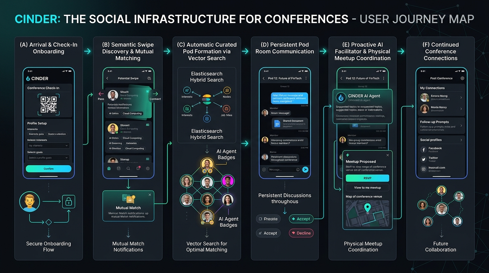
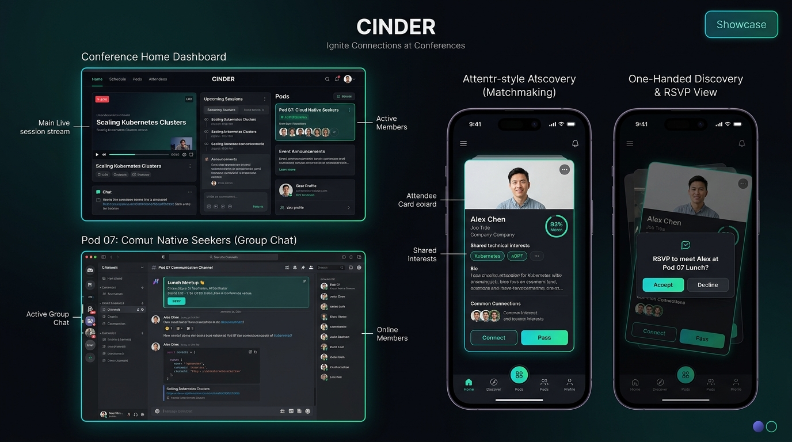

<!-- [LAYER: UI] -->
# CINDER — Complete Visual User Journey & Product Experience Blueprint

> **Product Promise:** *Discover your people. Find your Pod. Make something happen.*

---

## 01 — Product Audit Summary (Pass 1)

Before designing or modifying any surface, a full code and runtime audit of CINDER was conducted across `src/domain/`, `src/core/`, `src/infrastructure/`, `src/plumbing/`, and `src/ui/web/`.

### What Worked (Preserved Backend Foundation)
- **Domain Entities (`src/domain/`)**: Clean, zero-I/O models for [`Attendee`](../src/domain/attendee.mjs), [`Pod`](../src/domain/pod.mjs), [`Match`](../src/domain/match.mjs), [`Message`](../src/domain/message.mjs), [`Session`](../src/domain/agenda.mjs), and [`explainMatchRelevance`](../src/domain/relevanceScore.mjs).
- **Hybrid Retrieval & RRF (`src/infrastructure/ElasticsearchClient.mjs`, `src/plumbing/`)**: Dual-mode live/embedded Elasticsearch adapter supporting 32-dimensional cosine `dense_vector` kNN, BM25 lexical scoring, and Reciprocal Rank Fusion (`k=60`).
- **Core Use-Case Controllers (`src/core/`)**: Working [`CheckInController`](../src/core/CheckInController.mjs), [`DiscoveryController`](../src/core/DiscoveryController.mjs), [`PodOrchestrationController`](../src/core/PodOrchestrationController.mjs), [`CommunicationController`](../src/core/CommunicationController.mjs), [`FacilitatorController`](../src/core/FacilitatorController.mjs), and [`ScenarioRunner`](../src/core/ScenarioRunner.mjs).

### Prioritized Deficiencies Identified & Resolved
1. **Critical Discovery Rendering Bug (`src/ui/web/public/app.js`)**: `loadDiscoveryFeed()` guarded card rendering inside `if (document.getElementById("candidate-queue"))`, an element missing from `index.html`. Consequently, `currentCandidate` remained `null`, the swipe card displayed static placeholder text (`"Attendee Name"`), swipe buttons were non-functional, and the Elasticsearch Query Inspector never rendered the live Query DSL.
2. **Broken Candidate Property Mappings (`src/ui/web/public/app.js`)**: The client referenced `candidate.similarity` and `candidate.explanation.details`, whereas `DiscoveryController.getDiscoveryFeed()` returns `candidate.explanation.scorePercent`, `candidate.knnScore`, `candidate.bm25Score`, and `candidate.explanation.synergySummary`.
3. **Disconnected Single-Attendee Matching Ergonomics**: Swiping "Connect" in a fresh session only recorded a one-way swipe without surfacing reciprocal interest from high-affinity attendees or enabling organic Pod formation outside the automated demo runner.
4. **Missing Primary Product Surfaces**:
   - **Conference Home**: No overview answering what is happening now, what to do next, who the attendee is matched with, active Pod status, or latest facilitator announcements.
   - **Onboarding & Check-In (Journey A)**: `POST /api/check-in` existed, but no UI guided a new attendee through profile creation, interest/expertise selection, networking objectives, or how Pods work.
   - **Matches Surface (Journey B & F)**: `DiscoveryController.getMutualMatches()` was not exposed via HTTP or UI.
   - **Pod Room Context & Facilitator Controls (Journey C, D, E)**: Missing member roster, Pod composition rationale (`compositionMeta`), interactive physical meetup venue/time coordinator (`VENUE_LOCATIONS`), persistent RSVP tracking, and contextual AI Facilitator actions.
   - **Dynamic Conference Agenda & Notifications (Journey E & F)**: Agenda was hardcoded HTML rather than driven by `SEED_CONFERENCE_AGENDA` and `VENUE_LOCATIONS`; no notification center existed.
   - **Attendee Profile & Settings**: No surface to inspect or update the active attendee's profile, tags, projects, or re-index in Elasticsearch.
5. **Static Asset MIME Coverage (`src/ui/web/webServer.mjs`)**: Missing `.png`, `.jpg`, `.jpeg`, `.webp`, and `.ico` MIME mappings for serving visual assets.

---

## 02 — Visual User Journey Map & Screen Concepts (Pass 2)

### Journey A — Arrival and Onboarding
1. **Entry Point**: Attendee opens CINDER on Conference Home or launches the **Check In / Onboarding Wizard**.
2. **Immediate Product Clarity**: Hero banner and onboarding step 1 communicate the core promise (*Discover your people. Find your Pod. Make something happen.*) with visual storytelling (`cinder-onboarding-pods.jpg`).
3. **Conference Check-In**: Attendee enters or updates their name, role, company, and bio.
4. **Interests, Expertise & Objectives**: Attendee selects technical interests (e.g., `Kubernetes`, `eBPF`, `Autonomous Agents`), expertise, current projects, technical challenges, and networking objective (`looking_for`).
5. **Vector Indexing & Pod Explanation**: Submitting calls `POST /api/check-in`, generating a 32-dimensional normalized embedding vector, indexing the profile into `cinder_attendees`, broadcasting `attendee.checked_in` over SSE, and transitioning directly into Discovery.

### Journey B — Discovery and Matching
1. **Semantic Discovery Feed**: Attendee opens **Discover** (`GET /api/discovery`), which executes an Elasticsearch Hybrid Search (BM25 `multi_match` + 32-dim `dense_vector` kNN fused via RRF).
2. **Transparent Relevance Explanations**: Each attendee card displays the `scorePercent`% Hybrid Match badge, RRF/BM25/kNN telemetry, shared interests highlighted, complementary strengths, and a human-readable synergy summary.
3. **Tactile & Accessible Actions**: Attendee can Connect (`like`), Pass (`pass`), inspect the full profile drawer, or select from the upcoming RRF candidate queue. Keyboard shortcuts (`ArrowRight` / `ArrowLeft`) and touch drag physics are supported.
4. **Mutual Match Confirmation**: High-synergy connections establish a mutual match (`POST /api/swipe`), triggering the **Mutual Match Celebration Modal** with shared synergy context and direct actions to **Coordinate in Matches** or **Compose / Enter Pod**.

### Journey C — Pod Formation
1. **Curated Group Composition**: From the Match modal, Matches view, Home dashboard, or Pods sidebar, the attendee (or automatic match threshold) triggers Pod composition (`POST /api/pods/compose`).
2. **Elasticsearch Centroid Ranking**: `PodOrchestrationController` computes the vector centroid of seed members and queries Elasticsearch Hybrid Search to curate a balanced 4–5 person Pod around a shared theme (e.g., *Pod 07: Autonomous Cloud & Systems*).
3. **Room Provisioning & Rationale**: The Pod receives a persistent communication channel (`#pod-07-autonomous-cloud`), a member roster with RRF composition metadata explaining why the group was formed, and an automatic welcome introduction from the AI Facilitator.

### Journey D — Pod Communication & Physical Meetup Coordination
1. **Discord/Slack-Inspired Workspace**: Opening **Pods & Rooms** presents the channel sidebar, main conversation stream, pinned meetup header banner, and right-hand Member & Meetup Context panel.
2. **Message Differentiation**: Ordinary attendee messages, AI Facilitator interventions, and pinned system announcements are visually distinct.
3. **Physical Meetup Coordination**: Members can propose a meetup naturally in chat (e.g., *"Let's meet at Main Hall East Patio at 12:15 PM"*) or use the **Coordinate Meetup** selector (`VENUE_LOCATIONS`).
4. **Facilitator Detection & RSVP**: `AiFacilitatorEngine` detects meetup intent, pins the location and time to the Pod header (`meetup.pinned`), and enables one-tap **RSVP Confirmation** (`POST /api/pods/:podId/rsvp`) with live attendee counts.

### Journey E — Agent-Facilitated Participation
1. **Recognizable Facilitator Identity**: The CINDER AI Facilitator (`facilitator_ai`) participates with a dedicated badge, structured message cards, and contextual action chips (`📅 View Session`, `📍 Confirm RSVP`, `💡 Use Starter Prompt`).
2. **Proactive & On-Demand Facilitation**: Attendees can trigger or receive:
   - **Welcome & Introductions** (`welcomePod`) with clickable icebreaker starter chips.
   - **Technical Discussion Prompts** (`triggerDiscussionPrompt`) tailored to the Pod's shared interests.
   - **Agenda Transition Alerts** (`triggerAgendaAlert`) reminding the Pod of relevant upcoming talks and speaker appearances.

### Journey F — Continued Connections
1. **Matches & Direct Coordination**: In **Matches**, attendees review all mutual connections, read synergy breakdowns, send direct coordination notes, or launch a curated Pod with their matches.
2. **Interactive Conference Agenda**: In **Agenda**, attendees filter sessions by track, see which sessions feature Pod members, bookmark sessions to their personal schedule, and broadcast session alerts to their Pod.
3. **Notifications & Profile Continuity**: The **Notifications** center aggregates matches, Pod assignments, meetup confirmations, and facilitator alerts with one-click navigation, while **Profile** lets attendees refine their networking objectives as the conference evolves.

---

## 03 — Information Architecture & Navigation Model

| Primary Surface | Navigation ID | Purpose & Key Actions |
| :--- | :--- | :--- |
| **1. Conference Home** | `tab-home` | Live conference pulse, "What should I do next?" action cards, active Pod status, recent matches, facilitator broadcast, and 5-milestone tracker. |
| **2. Discover** | `tab-discover` | Tinder-inspired semantic swipe cards, "Why You Match" relevance breakdown, RRF candidate queue, and live Elasticsearch Query DSL inspector. |
| **3. Matches** | `tab-matches` | Mutual matches gallery, shared interests & complementary expertise, 1:1 quick message coordination, and one-click Pod formation. |
| **4. Pods & Rooms** | `tab-pods` | Persistent group chat channels, AI Facilitator prompts, pinned physical meetup strip with live RSVP, member roster, and venue coordinator. |
| **5. Agenda** | `tab-agenda` | Track-filtered conference schedule, "Happening Now / Up Next" indicators, venue directory, personal bookmarks, and Pod session alerts. |
| **6. Vector Radar** | `tab-radar` | Interactive 2D polar projection of 32-dim attendee embeddings and cosine affinity topology. |
| **7. Notifications** | `tab-notifications` | Categorized activity feed (Matches, Pods, Facilitator, Meetups, Agenda) with unread badges and contextual jump actions. |
| **8. Profile & Check-In** | `tab-profile` | Attendee profile editor, interest/expertise tag manager, networking objectives, live card preview, and New Attendee Check-In wizard. |

