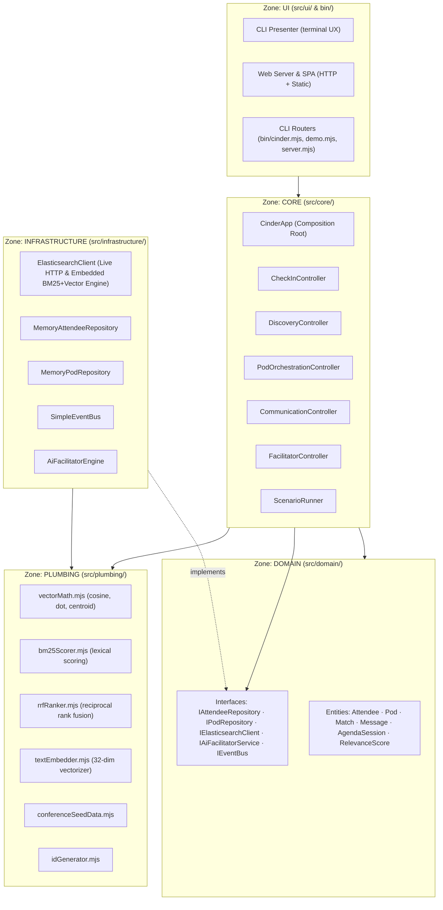
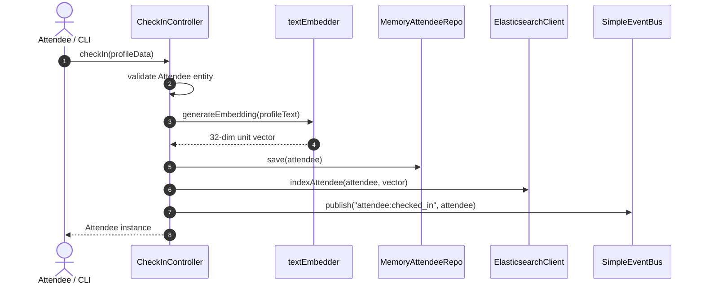
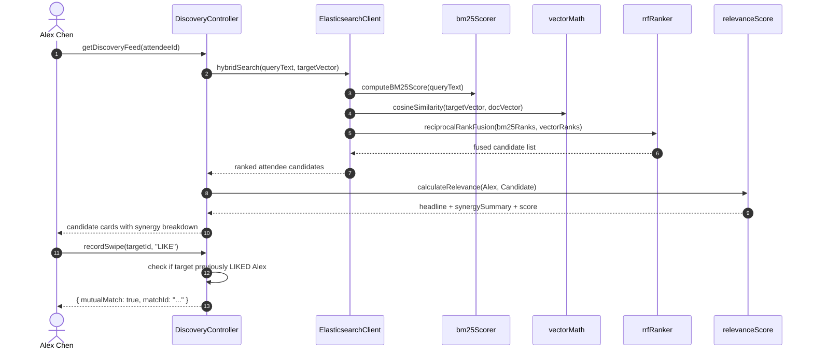
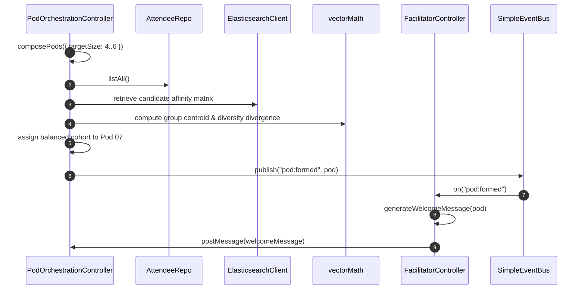

<!-- [LAYER: UI] -->
# CINDER System Architecture

Comprehensive architectural description of **CINDER — The Social Infrastructure for Conferences**.

---

## 1. Architectural Philosophy: Joyzoning

CINDER is built according to the **Joyzoning Architectural Standard** ([AGENTS.md](../../AGENTS.md)), which guarantees strict separation of concerns, high stability, and zero architectural drift.

The codebase is organized into five canonical zones:

---

## 2. Five Canonical Zones Breakdown

### A. DOMAIN (`src/domain/`)
- **Purity:** Contains zero network or disk I/O, no references to databases, and no UI presentation logic.
- **Entities:**
  - `Attendee`: Represents a registered conference attendee, validating name, role, company, interests, skills, and challenges.
  - `Pod`: Represents a group of 4–6 attendees, maintaining member IDs, channel metadata, message logs, and pinned meetup locations.
  - `Match`: Encapsulates swipe actions (`LIKE` / `PASS`) between two attendees and tracks mutual connection status.
  - `Message`: Represents a communication unit in a Pod channel, capturing sender, content, timestamp, and pinned flag.
  - `AgendaSession`: Models a conference session, track, speaker, room, and start/end time.
  - `RelevanceScore`: Represents the computed synergy between two attendees and generates human-readable explanations.
- **Formal Interfaces (`src/domain/interfaces/`):**
  - `IAttendeeRepository`, `IPodRepository`, `IElasticsearchClient`, `IAiFacilitatorService`, `IEventBus`.

### B. CORE (`src/core/`)
- **Orchestration:** Encapsulates use cases and workflow rules. Depends on domain models and formal domain interfaces.
- **Controllers:**
  - `CinderApp`: Composition root container wiring together infrastructure adapters, domain models, and controllers.
  - `CheckInController`: Validates attendee input, generates vector embeddings, stores profile in repository, and indexes into Elasticsearch.
  - `DiscoveryController`: Queries Elasticsearch hybrid search, calculates synergy scores, ranks candidates, and records swipe gestures.
  - `PodOrchestrationController`: Formulates pods by combining mutual swipe connections with semantic centroid cohesion and discipline diversity.
  - `CommunicationController`: Manages pod messaging and executes regex pattern matching for physical meetup detection.
  - `FacilitatorController`: Drives the proactive AI Facilitator lifecycle (introductions, icebreakers, agenda alerts, meetup confirmation).
  - `ScenarioRunner`: Drives the 10-step continuous hackathon demonstration.

### C. INFRASTRUCTURE (`src/infrastructure/`)
- **Adapters:** Concrete implementations of formal domain interfaces.
- `ElasticsearchClient`: Implements `IElasticsearchClient`. Supports dual-mode: live HTTP cluster integration with 250ms timeout or embedded zero-dependency search engine.
- `AiFacilitatorEngine`: Implements `IAiFacilitatorService`. Formulates prompts, structures welcomes, synthesizes discussion topics, and checks schedule constraints.
- `MemoryAttendeeRepository` & `MemoryPodRepository`: Fast, thread-safe in-memory collections.
- `SimpleEventBus`: Implements `IEventBus`. In-process publish/subscribe message dispatcher.

### D. PLUMBING (`src/plumbing/`)
- **Stateless Primitives:** Leaf helpers with zero external dependencies and zero imports from other zones.
- `vectorMath.mjs`: High-performance dot product, vector magnitude, cosine similarity, vector normalization, and centroid calculation.
- `bm25Scorer.mjs`: Tokenizer, term frequency map, inverse document frequency, and BM25 score calculation.
- `rrfRanker.mjs`: Reciprocal Rank Fusion algorithm ($k=60$) merging lexical and vector rank positions.
- `textEmbedder.mjs`: Deterministic 32-dimensional domain keyword-weighted vector embedder.
- `conferenceSeedData.mjs`: Seed data for 5 diverse conference attendees and agenda sessions.
- `idGenerator.mjs`: Cryptographic collision-resistant unique ID generator.

### E. UI (`src/ui/` & `bin/`)
- **Presentation:** Consumes core controllers to deliver terminal and web experiences.
- `cliPresenter.mjs`: ANSI color-coded formatting for step banners, attendee cards, pod rosters, chat bubbles, and health statistics.
- `webServer.mjs`: Native Node HTTP server serving static frontend assets and REST API endpoints (`/api/status`, `/api/attendees`, `/api/discovery`, `/api/swipe`, `/api/pods`, `/api/scenario/run`).
- `web/public/`: Browser Single Page Application (HTML, CSS, JS).

---

## 3. End-to-End Data Flow Pipelines

### Pipeline 1: Attendee Check-In & Indexing

### Pipeline 2: Hybrid Discovery Query & Swipe Matching

### Pipeline 3: Automated Pod Formation

