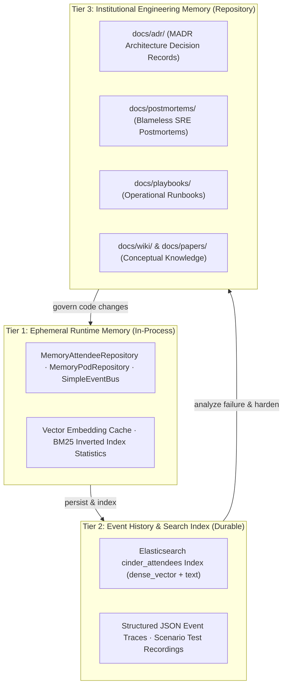

<!-- [LAYER: UI] -->
# 3-Tier Knowledge Handling Architecture

This guide describes how knowledge, state, and operational experience are captured, organized, and retrieved in CINDER.

---

## The 3 Tiers of Knowledge

---

## 1. Tier 1: Ephemeral Runtime Memory
- High-speed in-memory data structures living within the Node.js process heap.
- `MemoryAttendeeRepository` and `MemoryPodRepository` provide O(1) lookups for active chat sessions, attendee lookups, and channel subscriber lists.
- Bounded caches store pre-computed unit vectors and BM25 term frequency maps.

## 2. Tier 2: Search Index & Event Stream
- Primary search intelligence housed in Elasticsearch (`cinder_attendees` index).
- Stores full attendee profile text alongside 32-dimensional dense embeddings with cosine similarity parameters.
- Emits structured domain events over `SimpleEventBus` to notify facilitators and subscribers of state transitions.

## 3. Tier 3: Institutional Engineering Memory
- Human and machine-readable markdown documents checked directly into git under `docs/`.
- **ADRs (`docs/adr/`):** Immutable records of architectural choices.
- **Postmortems (`docs/postmortems/`):** Codified operational lessons preventing recurring failures.
- **Playbooks (`docs/playbooks/`):** Step-by-step triage procedures for operators during live conferences.
- Verified continuously via `npm run check` and automated test suites.

