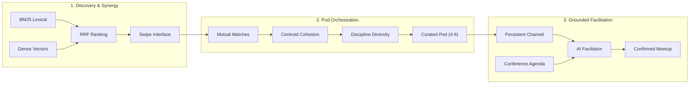

<!-- [LAYER: UI] -->
# CINDER Engineering Wiki

A deep conceptual encyclopedia of mental models, mathematical formulations, search algorithms, group formation theories, and agent designs powering CINDER.

---

## Wiki Articles

| Topic | Article | Description |
| :--- | :--- | :--- |
| **Conceptual Architecture** | [mental-models.md](mental-models.md) | The 4 core mental models: Hearth, Spark, Catalyst, and Boundary |
| **Search & Retrieval** | [hybrid-search-and-rrf.md](hybrid-search-and-rrf.md) | Mathematics and implementation of BM25, dense vectors, and Reciprocal Rank Fusion |
| **Group Dynamics** | [pod-composition-algorithms.md](pod-composition-algorithms.md) | Multi-objective optimization for high-trust, diverse cohort formation |
| **Autonomous Agents** | [agent-facilitator-design.md](agent-facilitator-design.md) | Event-driven reactive loops, prompt grounding, and safety barriers for the AI Facilitator |

---

## Conceptual Overview

