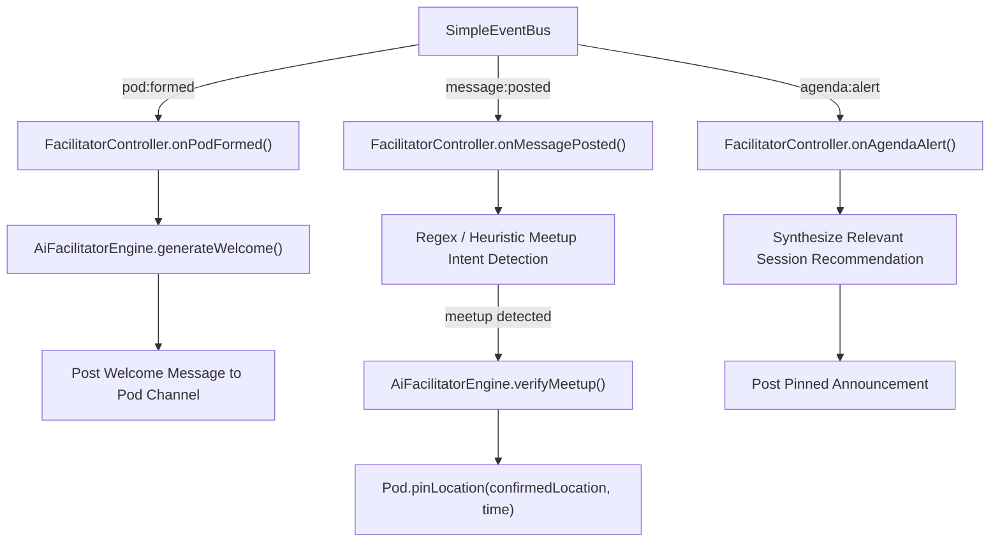

<!-- [LAYER: UI] -->
# AI Agent Facilitator Design & Reactive Event Loops

Detailed engineering design of the autonomous, proactive AI Facilitator powering CINDER Pods.

---

## 1. Architectural Philosophy

Traditional chatbots are **reactive listeners**: they wait for user prompts and reply statelessly. 

In a conference setting, this produces dead silence: attendees don't know what to ask the bot, and the bot doesn't know who is in the room.

The CINDER Facilitator is an **autonomous, proactive event-driven coordinator**:
- It listens to the conference pulse: schedule clocks, room announcements, attendee swipes, and pod chat channels.
- It initiates interactions when value can be added (introductions, session alerts, icebreakers).
- It steps back into the background when human attendees are actively conversing.

---

## 2. Reactive Event Subscriptions

The Facilitator is wired to domain events via `SimpleEventBus`:

---

## 3. Strict Prompt Grounding & Guardrails

To prevent hallucinations and protect attendee safety:

1. **Agenda Grounding:** Session titles, speakers, rooms, and times are injected directly from verified `AgendaSession` entities in `CinderApp.agenda`. The agent is instructed never to invent room names or change session schedules.
2. **Deterministic Fallback Templates:** If an external LLM API is unavailable, `AiFacilitatorEngine.mjs` falls back to deterministic rule-based template generation, ensuring 100% operational continuity.
3. **No Executive Authority:** The facilitator can pin messages and suggest locations, but cannot modify attendee registrations, remove members, or issue conference-wide alerts without human operator approval.

